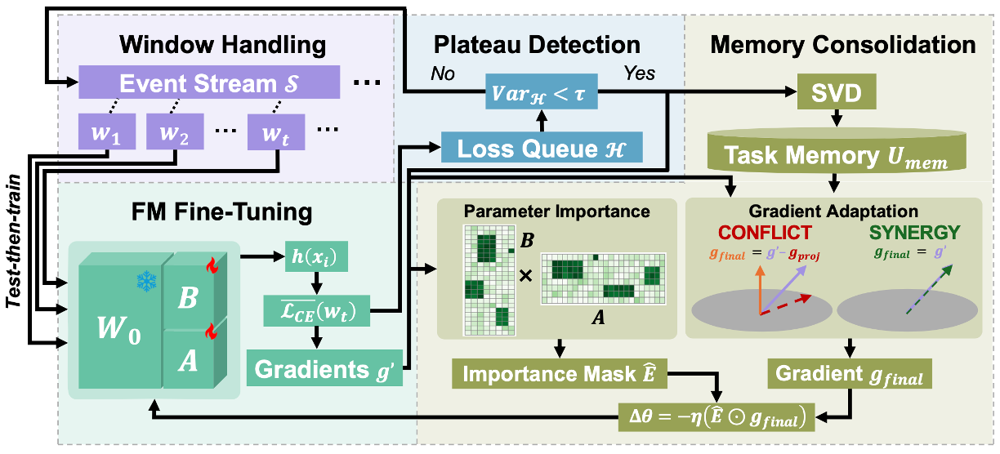

# CONAP-FM

**Sustainable Online Continual Learning for Foundation Process Prediction Models**

Code for the ICPM paper *Towards Foundation Process Prediction Models: Sustainable Online Continual Learning*.

CONAP-FM keeps a pretrained language model frozen and adapts it online to a stream of process events for next activity prediction.
Only LoRA adapters and a linear head are trained, on top of Tiny-LLM (about 10M parameters) or DistilGPT2 (about 82M parameters).



1. **Test then train.** Every window of the event stream is first used for prediction and then for training.
2. **Plateau trigger.** When the variance of the last N = 5 window losses drops below tau, the current concept is consolidated. A cooldown of C windows follows. No drift detector or task boundary is needed.
3. **Gradient memory and CaGA.** Consolidated gradient subspaces are kept as an SVD basis (95% energy). If the share rho of a new gradient inside this memory exceeds epsilon = 0.05, the part inside the memory is removed (orthogonal projection) before the Adam step, so new concepts do not overwrite old ones.

## Results

Accuracy over the event stream (evaluation split, seed 40) for CONAP-FM with Tiny-LLM and the competing methods. Dashed lines mark known drifts.
In the paper, CONAP-FM reaches the highest accuracy on nine of the ten logs (Table 2).


Runtime and throughput of all methods are in [`Results/`](Results/runtime_results.md) (Table 4 and Fig. 5 of the paper).

## Install

```bash
python -m venv venv && source venv/bin/activate
pip install -r requirements.txt
```

The backbones `arnir0/Tiny-LLM` and `distilbert/distilgpt2` are downloaded from the Hugging Face hub on first use. A GPU is recommended.

## Data

The repository contains no event logs. Put each log in `Data/<name>.csv` with the columns `case`, `event` and `completeTime`.
The ten logs and their names are listed in [`Data/README.md`](Data/README.md).
Hyperparameters are chosen on the first 15% of the cases (`--data-split validation`). All results use the remaining 85% (`--data-split evaluation`).

## Usage

```bash
python smoke_test.py --dataset DomesticDeclarations                 # quick end to end check
python run_experiments.py --datasets DomesticDeclarations --configs full --seeds 40 41 42 --out runs/all
python run_experiments.py --datasets DomesticDeclarations --configs full \
    --model-name distilbert/distilgpt2 --out runs/distilgpt2        # second backbone
python -m Analysis.analyze --results runs/all/results --reference full --out runs/analysis
```

`run_experiments.py` takes the per log settings of Table 1 from `Setup/hparams.py` and `Setup/final.py`.
Each run writes `<out>/results/<log>__<configuration>__seed<seed>.json`. Finished runs are skipped, so interrupted jobs can be restarted.
Add `--dry-run` to print the commands only.

| Configuration | Description |
|---|---|
| `full` | CONAP-FM |
| `forward`, `neither` | plain sequential LoRA, memory that is never used |
| `with_mask`, `no_caga` | importance mask variants (ablation only) |
| `oracle`, `fixed`, `adwin`, `page_hinkley` | other consolidation triggers |
| `full_ft`, `random_full`, `random_lora` | full fine tuning, random initialisation, random frozen backbone |
| `<tag>_pre` | start from adapters pretrained on a second log (`Methods/CONAP_FM/pretrain_offline.py`) |

Groups `all_ablation`, `triggers`, `backbone` and `all` run several configurations at once.

## SLURM

`slurm/` has one job array script per experiment (main runs, ablation, triggers, backbones, pretraining, grids) and `submit_all.sh` to submit everything.
Edit the module names and partition in `slurm/env.sh` and the `#SBATCH` lines first. `BACKBONE=distilgpt2` switches the backbone. Seeds are 40 to 49.

## Repository structure

```text
Methods/CONAP_FM/   run.py, engine.py (test then train, triggers), calora_handler.py (memory and CaGA), pretrain_offline.py
Setup/              hparams.py, final.py, drifts.py and the log handling code
Utils/              preprocessing, stream and metrics
Analysis/           statistics, runtime tables and grid selection
Results/            runtime and throughput tables of the paper
slurm/              cluster scripts
```
